

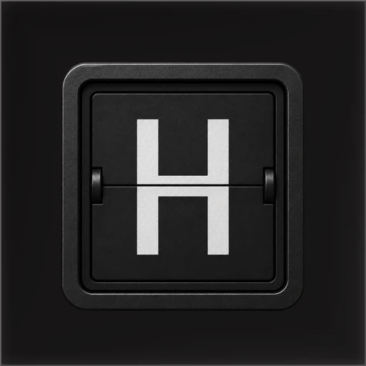

# Hearth (Hearthboard)

**A split-flap social board for very short messages: friends see posts in-app and on a home-screen widget; an engineering Android TV build pairs by QR for ambient living-room display (TV app not publicly released).**

**Android phone and tablet · iOS client · Android TV (unreleased engineering build)** 
Flutter · Dart · Kotlin · Swift · Firebase · Play Billing · StoreKit · Cloudinary

<table>
  <tr>
    <td>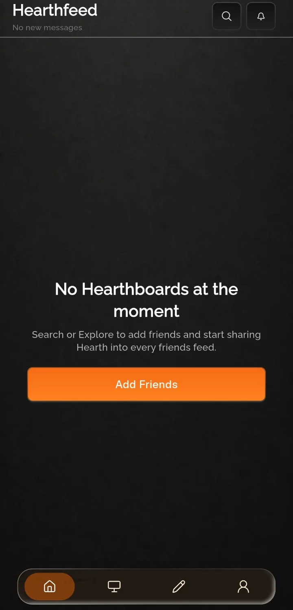</td>
    <td></td>
  </tr>
</table>
Real screenshots from the Android build, cropped to the app content, captured with sample or empty data, metadata removed. No Android TV UI screenshots are published in this repository.

---

## Get the App

  

The Android TV companion app is **engineered but not publicly released**. There is **no TV store link** in this showcase. TV capability is described in the docs and shown only through launcher banner artwork labelled as artwork.

## Product at a Glance

| | |
|---|---|
| **What it is** | Send short uppercase “board” messages to friends; read them in a feed and on a home-screen widget styled like a split-flap display |
| **Social** | Friend requests, search, block list, reactions, optional partner board |
| **Widget** | Native home-screen widget shows a pre-rendered bitmap of the feed card (light/dark and platform-specific sizes) |
| **TV (unreleased)** | Phone pairs over QR; TV loops friend boards for ambient display after pairing |
| **Platforms** | Mobile Flutter app (Android live on Google Play; iOS in the same codebase). Separate Flutter fork for Android TV (not released) |
| **Backend** | Firebase Auth, Firestore, Storage, Cloud Messaging, Analytics, Crashlytics, Performance; serverless handler for new-message pushes |
| **Monetisation** | Tiered subscriptions (basic / pro / max) via store in-app purchase APIs |
| **Code size** | About 61,200 lines of Dart in the mobile app and 39,500 in the TV fork (`lib/` each) |

## Showcase

<table>
  <tr>
    <td align="center">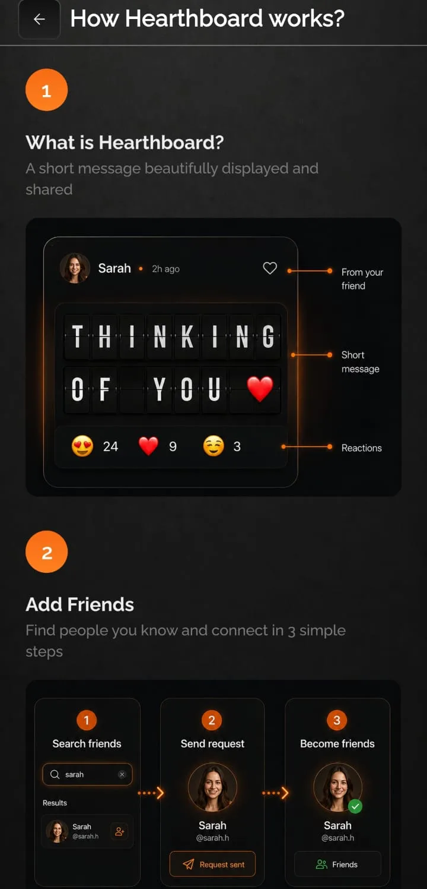 <b>How it works</b> Product education</td>
    <td align="center">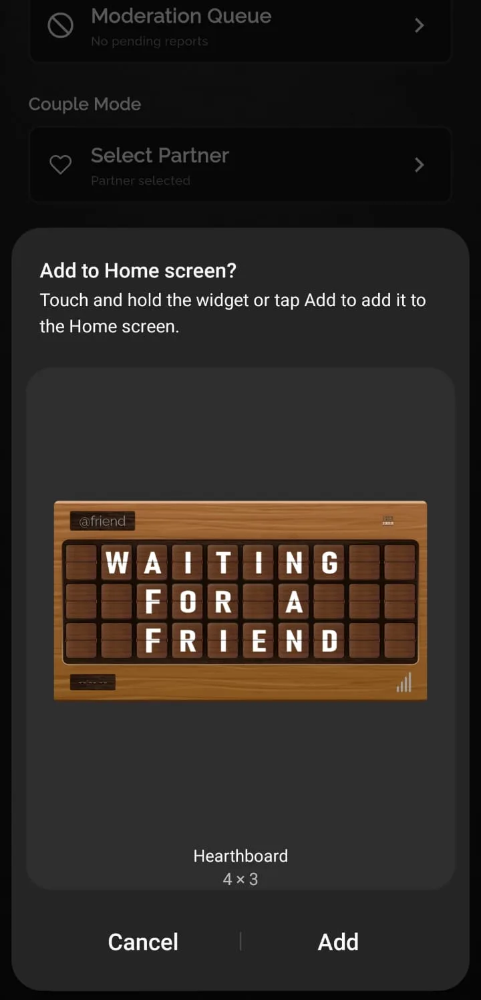 <b>Widget prompt</b> Onboarding overlay</td>
    <td align="center">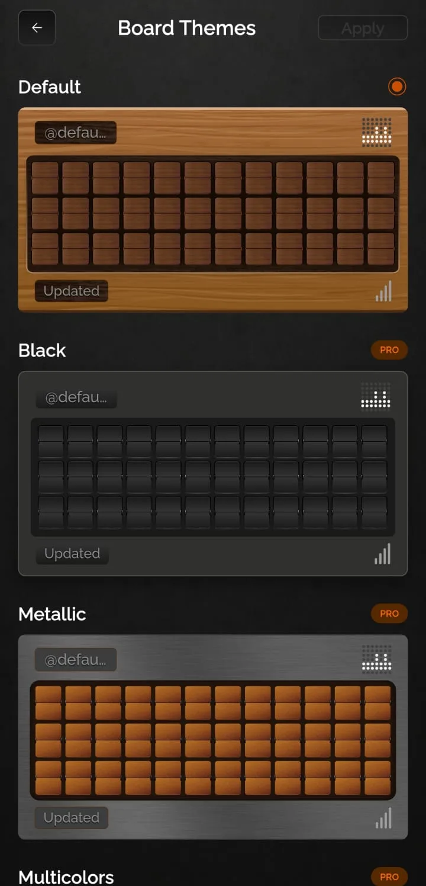 <b>Board themes</b> Visual customisation</td>
  </tr>
  <tr>
    <td align="center">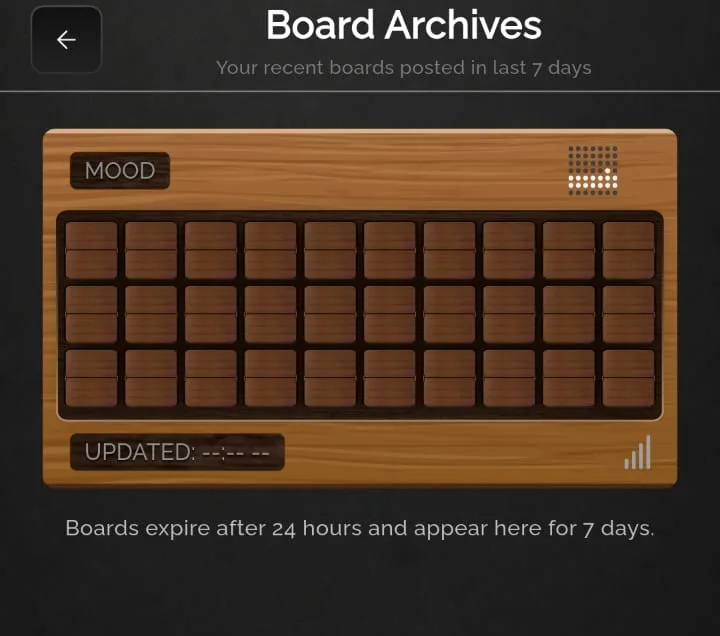 <b>Archives</b> Past boards</td>
    <td align="center">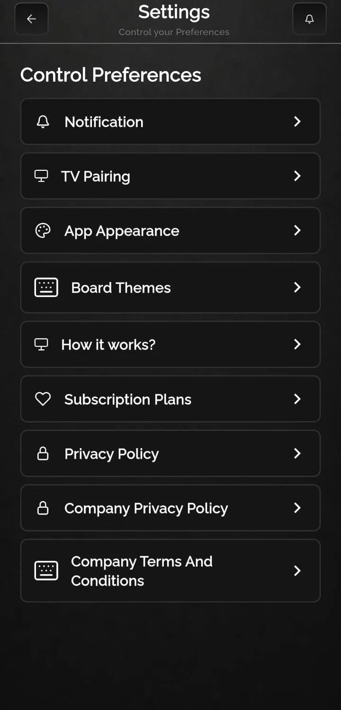 <b>Settings</b> Account and preferences</td>
    <td align="center">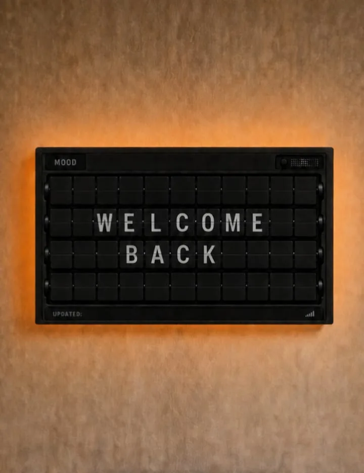 <b>Sign in</b> Auth entry</td>
  </tr>
</table>

## Two Platforms, Two Codebases

The mobile app optimises for compose, social graph, widgets, and phone-led TV pairing. The TV fork optimises for ten-foot UI, D-pad focus, QR pairing on the display, and an ambient board loop. They share a large overlapping Dart tree (191 paths, 53 byte-identical files) but ship as separate projects.

  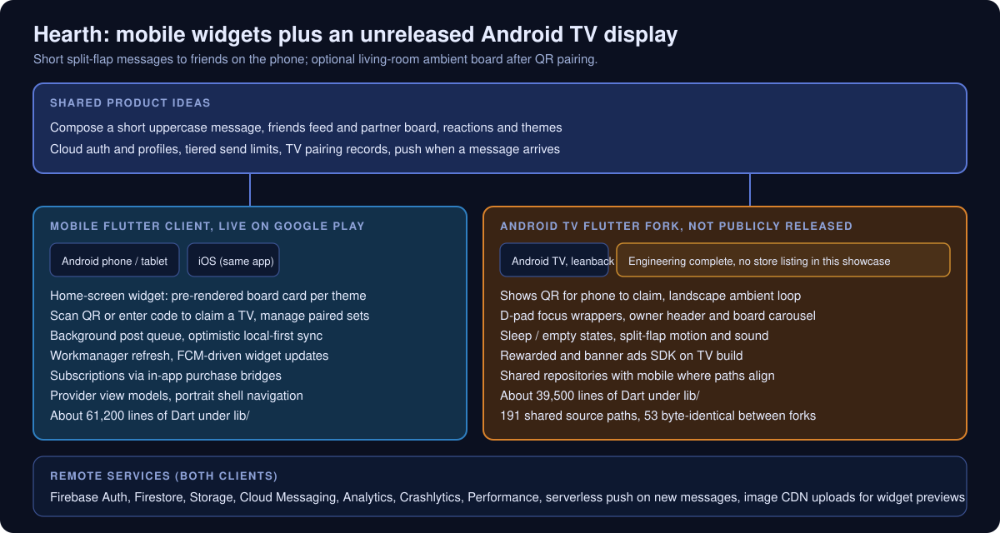

<table>
  <tr>
    <td width="50%" align="center"> <b>Android TV (unreleased)</b>: launcher banner artwork (artwork, not a screenshot)</td>
    <td width="50%" align="center">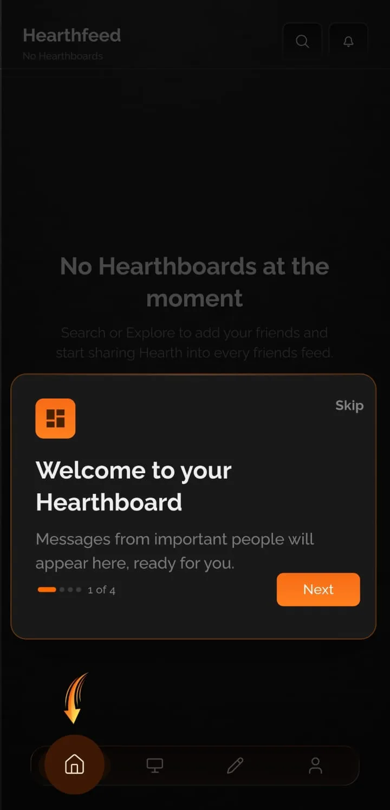 <b>Mobile</b>: onboarding tip (real Android screenshot)</td>
  </tr>
</table>

| | Mobile (Google Play) | Android TV (not released) |
|---|---|---|
| **Primary UX** | Feed, compose, friends, profile | Ambient board loop after pairing |
| **Widget** | Friend and partner home-screen widgets | Full-screen display only |
| **Pairing** | Scan QR / enter code on phone | Show QR on TV |
| **Input** | Touch | D-pad focus |
| **Background work** | Workmanager widget refresh | None equivalent |
| **Ads** | Subscription-focused on mobile paths | Mobile Ads SDK present in TV project |
| **Orientation** | Portrait shell | Landscape |

Full comparison: [docs/MOBILE_VS_TV.md](docs/MOBILE_VS_TV.md).

## Engineering Highlights

### Launcher widgets via off-screen renders
- **Problem:** Home-screen widgets cannot run the full Flutter board layout reliably on Android and iOS.
- **Approach:** Render the same feed card off-screen at fixed sizes (including a distinct iOS aspect ratio), upload light/dark previews, store HTTPS URLs on each message, and let native widget code display the matching bitmap.
- **Outcome:** Feed and widget stay visually aligned; theme changes on already-delivered messages depend on stored previews, not live relayout.

  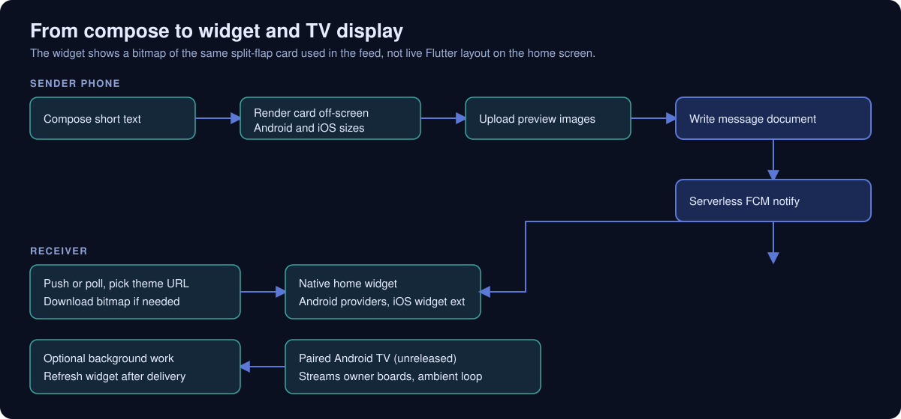

### Sends that do not freeze compose
- **Problem:** Broadcasting to many friends involves multiple writes and uploads.
- **Approach:** A background post queue tracks jobs (friends vs partner), states, and errors while the shell remains navigable.
- **Outcome:** Compose feels instant; failures surface asynchronously.

### QR TV pairing without typing on a remote
- **Problem:** TVs lack a practical keyboard for account linking.
- **Approach:** The unreleased TV app publishes a short code as QR; the signed-in phone claims it, binding owner identity in local TV storage and cloud pairing records both sides subscribe to.
- **Outcome:** Living-room setup stays phone-driven; TV code remains unreleased to the public store.

### Push that honours notification toggles
- **Problem:** Users disable friend or partner message alerts independently.
- **Approach:** A serverless Firestore trigger reads recipient preference maps before sending FCM.
- **Outcome:** Category-aware pushes without duplicating policy in every client version.

### More

| Area | What was built |
|---|---|
| **State** | Provider view models over Firestore repositories |
| **Sync** | Optimistic local-first helper for settings and profile fields |
| **Social** | Friends, requests, blocks, partner board, reactions, archives |
| **TV gating** | Plan-aware quotas for custom TV pushes from the phone |
| **Analytics** | Layered event registry, queues, journey and paywall helpers |
| **Tests** | Mobile widget layout tests and analytics suite; TV widget and ad analytics tests |

Details: [docs/ENGINEERING_CHALLENGES.md](docs/ENGINEERING_CHALLENGES.md).

## Architecture

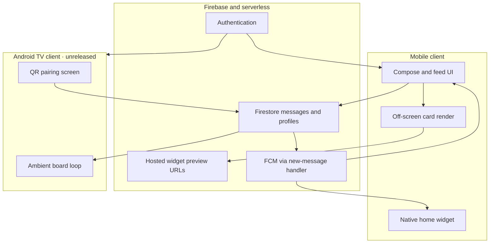

More diagrams: [docs/ARCHITECTURE.md](docs/ARCHITECTURE.md).

## Honest Trade-offs

- **Two Flutter repos** share many files but not a package; messaging or subscription changes may require dual maintenance.
- **Bitmap widgets** trade bandwidth and storage for launcher fidelity.
- **Client-side tier checks** read plan fields on profiles; server-side receipt validation would tighten enforcement.
- **Android TV** is not shipped; banner artwork here is not evidence of a live TV listing.
- **iOS** shares the mobile codebase and widget pipeline; this README links only the Google Play listing provided for the live Android release.

## Technology Stack

| Layer | Technology |
|---|---|
| UI | Flutter / Dart 3, Provider |
| Mobile widgets | home_widget plugin, native Android providers, iOS extension |
| Backend | Firebase Auth, Firestore, Storage, Cloud Messaging, Analytics, Crashlytics, Performance |
| Push side effects | Node Cloud Functions on Firestore creates |
| Image hosting | Client upload service (CDN) for widget previews |
| Background | workmanager on mobile |
| Billing | in_app_purchase (Play Billing and StoreKit) |
| TV | Leanback manifest, focus wrappers, google_mobile_ads on TV fork |
| QR | mobile_scanner on phone; qr_flutter on TV |

## Documentation

| Read | For |
|---|---|
| [Product overview](docs/PRODUCT_OVERVIEW.md) | User journeys, widget, TV pairing, subscriptions (conceptual) |
| [Technical case study](docs/TECHNICAL_CASE_STUDY.md) | End-to-end engineering narrative |
| [Architecture](docs/ARCHITECTURE.md) | Layers, flows, technology map |
| [Mobile vs TV](docs/MOBILE_VS_TV.md) | Platform comparison (TV labelled unreleased) |
| [Engineering challenges](docs/ENGINEERING_CHALLENGES.md) | Problem → approach → outcome |
| [Privacy and source](docs/PRIVACY_AND_SOURCE.md) | What is and is not published |

## Source Code

This repository is a portfolio showcase for a production application. Production source code is maintained privately. See [RIGHTS.md](RIGHTS.md) for usage terms.
