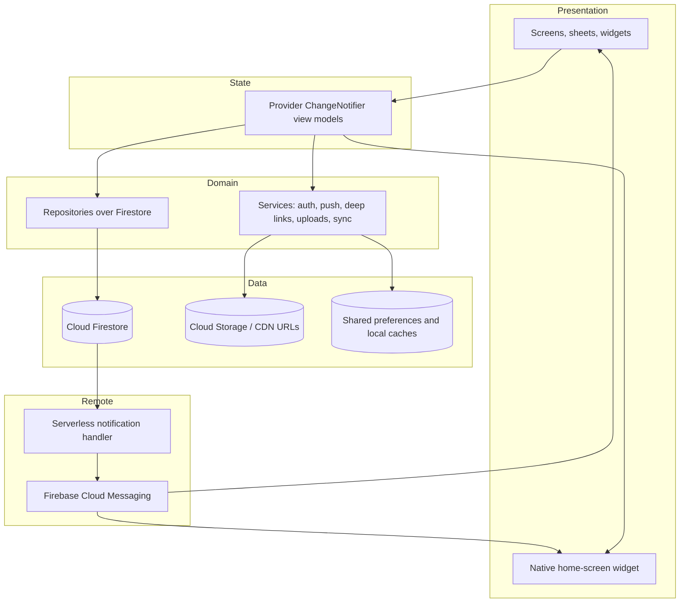
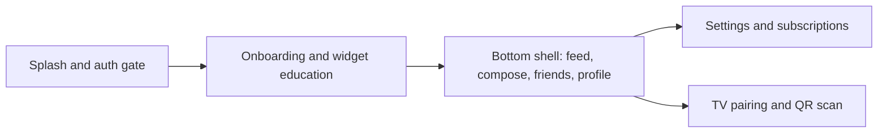
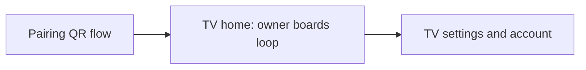

# Architecture

Diagram labels are conceptual and do not correspond to production identifiers.

## System overview

  

Hearth is a cloud-backed social app with two Flutter front ends. The mobile client is listed on Google Play; the Android TV client is engineered but not publicly released. Remote services handle authentication, structured message storage, file hosting for widget bitmaps, push delivery, and operational telemetry.

## Message and widget pipeline

  

Compose gathers text and recipients, validates plan limits, renders the split-flap card off-screen, uploads themed previews, then writes the message and triggers notification logic. Receivers update in-app state, download images if needed, and call the native widget APIs. Optional background tasks on mobile retry widget refresh when pushes arrive off-screen.

## Layers

| Layer | Responsibility |
|---|---|
| **Presentation** | Material shell, feed cards, compose, friends, profile, settings, TV pairing UI on mobile; TV home loop and pairing on the unreleased fork. |
| **State** | View models expose loading, error, and list state; streams from repositories propagate pairing and feed updates. |
| **Domain** | Repositories encapsulate queries and writes for messages, friends, pairings, reactions, and subscriptions. Services wrap auth, connectivity guards, optimistic sync, and notification routing. |
| **Data** | Firestore holds profiles, messages, pairing records, and preference maps. Binary widget previews live at HTTPS URLs stored on messages. Local storage caches tokens, pairing UIDs, and widget download paths. |
| **Remote** | A small Node serverless module reacts to new message documents and sends FCM payloads respecting user notification preferences. |

## Mobile shell

Entry navigation decides among splash, onboarding, sign-in, and the main shell based on auth and stored flags. The shell keeps a tab index service so background post completion can return the user to compose or feed.

## Android TV shell (unreleased)

If local storage lacks a paired owner UID, the TV app replaces the stack with the pairing screen. After success, a boards view model streams friend posts for ambient display.

## Pairing model

The TV generates a short-lived pairing code and shows it as QR. The phone claims the code against the signed-in user, which binds owner UID and optional friend visibility rules. Both sides subscribe to the pairing record for rename, disconnect, and quota state used when pushing custom TV content from the phone.

## Analytics and observability

Both codebases embed a layered analytics toolkit: event registry, queued dispatch, journey and paywall helpers, HTTP interceptors, performance traces, and Crashlytics hooks. Screen mixins standardise feature-open events. This is instrumentation architecture, not a claim about dashboard usage.

## Native bridges

Android declares two app widget providers for the friend and partner slots. iOS uses the home_widget plugin’s extension name. Kotlin and Swift host widget update entry points referenced from Dart. Mobile scanner drives QR capture for TV pairing on the phone.

## Technology map

| Concern | Approach |
|---|---|
| UI | Flutter 3, Material, custom split-flap card widget |
| State | Provider |
| Backend | Firebase Auth, Firestore, Storage, FCM, Analytics, Crashlytics, Performance |
| Push side effects | Serverless Firestore trigger formatting notification title/body |
| Widget images | Off-screen render, upload to image CDN, URLs on message documents |
| Background | Workmanager tasks on mobile for widget refresh |
| Billing | in_app_purchase with platform store APIs |
| TV ads | google_mobile_ads on TV project |

## Related reading

- [Mobile vs TV](MOBILE_VS_TV.md) for platform comparison
- [Engineering challenges](ENGINEERING_CHALLENGES.md) for problem-focused notes
- [Technical case study](TECHNICAL_CASE_STUDY.md) for end-to-end narrative
