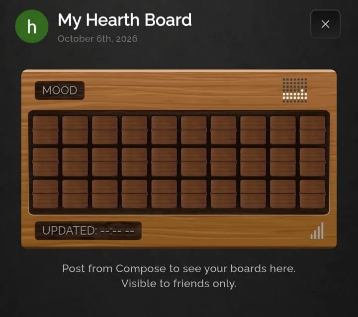
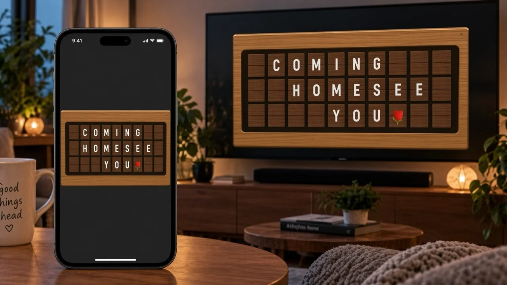

# Mobile vs Android TV

Hearth ships as two Flutter projects: a mobile client (Android and iOS) that is live on Google Play under the name **Hearth**, and an Android TV fork that is **engineered but not publicly released**. This document compares them.

## Relationship between the apps

| Codebase | Platforms | Technology |
|---|---|---|
| Mobile app | Android phone and tablet, iOS | Flutter / Dart, with native Android and iOS widget extensions |
| Android TV app | Android TV (leanback) | A separate Flutter project sharing many Dart files with mobile |

Of the Dart source paths that exist in both projects under `lib/`, 191 paths overlap and 53 files are byte-identical (including several analytics helpers, theme assets, and shared repositories). The remaining shared paths have diverged as TV shed phone-only features (home widget pipeline, workmanager, some shell tabs) and gained TV home, focus, and ad surfaces. The TV codebase is smaller (about 39,500 lines of Dart against about 61,200 for mobile, each counted under `lib/`).

<table>
  <tr>
    <td align="center"> <b>Mobile</b>: board preview and widget render source (real Android screenshot)</td>
    <td align="center"> <b>Android TV</b>: launcher banner artwork (artwork, not a screenshot). App not publicly released.</td>
  </tr>
</table>

No TV feed or pairing screenshots exist in this showcase. TV behaviour is described from the source and illustrated by diagrams.

## Comparison

| Dimension | Mobile (Android and iOS) | Android TV (unreleased) |
|---|---|---|
| UI toolkit | Flutter | Flutter |
| Manifest posture | Standard launcher activity | Leanback required, TV launcher entry and banner |
| Orientation | Portrait shell | Landscape living-room layout |
| Primary surface | Friends feed, compose, profile, settings | Ambient board loop after pairing |
| Home-screen widget | Yes: native providers render uploaded card bitmaps | No widget; full-screen display |
| TV pairing | Phone claims QR or typed code; manages paired sets | TV shows QR; pending until claimed |
| Input | Touch, keyboard, scanner for QR | D-pad focus wrappers (`TvFocusable`) |
| Message send | Full compose, friends, partner, background queue | Display-only; no compose on TV |
| State management | Provider `ChangeNotifier` view models | Same pattern on shared screens |
| Navigation | Imperative `Navigator` stack from splash and shell | Reduced shell; pairing gate when unpaired |
| Background work | Workmanager for widget refresh tasks | None equivalent |
| Push | FCM plus local notifications | FCM for relevant events |
| Ads | Mobile monetisation via subscriptions; ad stack differs by build | Google Mobile Ads SDK on TV project |
| Purchases | In-app purchase plugin (Play and StoreKit paths) | Subscription screens present in shared UI |
| Media uploads | Image CDN for widget previews | Consumes URLs from messages |
| Analytics | Firebase Analytics, Crashlytics, Performance | Same Firebase products |
| Audio | Split-flap flip sounds | Same sound service on shared code |
| Tests | Widget layout tests, analytics test suite | Widget smoke test, analytics and ad analytics tests |

## Interaction differences

### Mobile (touch)

Users move through a bottom shell (feed, compose, friends, profile, settings). Compose enforces character and daily limits based on plan. Sending may continue in a background queue with a status affordance in the shell. The widget onboarding flow explains adding the home-screen widget. TV management lives under profile or settings entry points: scan QR, type a code, rename a display, disconnect, or hide boards from specific friends.

Deep links and invite links can route into friend flows; exact URL schemes are not published here.

### Android TV (D-pad)

There is no touch requirement. Focusable wrappers move highlight between actionable regions. When no owner is paired locally, the app routes to a pairing screen that cycles QR presentation phases (generate, connecting, success, error). After pairing, the home screen subscribes to the owner’s friend-board stream and animates split-flap transitions between posts, with empty and sleep presentations when the stream is idle.

Settings on TV cover appearance, account, notifications, and download prompts that point users to the phone app for full social features.

## UI and screen differences

- Mobile emphasises social discovery, compose, reactions, archives, hidden boards, and subscription plans. TV emphasises legibility at distance, owner identity in the header, and a carousel of friend boards.
- Mobile renders widget cards at two aspect ratios (Android-shaped and iOS systemMedium-shaped). TV scales the in-app card widget to the viewport without exporting to the launcher.
- Mobile includes partner-specific widget and feed treatments. TV partner behaviour follows shared repositories where those screens exist in the fork.

## Navigation and focus

Mobile navigation is touch-driven with a glass-style bottom bar and modal bottom sheets for errors and actions. TV navigation reuses many of the same routes but wraps controls for directional focus and uses full-screen dialogs tuned for ten-foot UI.

## Performance considerations

- Widget updates depend on bitmap download size and cache behaviour; the app precaches letter assets for rendering.
- TV board loops may hold multiple large cards in memory while animating; the view model streams from the cloud database rather than polling aggressively.
- Both apps attach a broad analytics layer (queued events, journey and paywall helpers). No latency or frame-rate figures are published in this showcase.

## Code reuse and platform-specific implementation

**Reused concepts:** split-flap visual language, message and post models, friend and pairing repositories, auth and user profile storage, subscription gating helpers, theme visuals, analytics dispatch pattern.

**Reused code:** substantial shared `lib/` tree (191 paths), with 53 files still identical between forks.

**Platform-specific:** entire home-widget render and upload pipeline (mobile only), workmanager integration (mobile only), TV home loop and pairing QR flow (TV only), leanback manifest and focus primitives (TV only), ad placement wiring (differs), shell tab set (mobile richer).

## Honest trade-offs

- Two Flutter repos mean pairing, messaging, or subscription rule changes may need two edits unless shared code is extracted into a package.
- Widget fidelity depends on pre-rendered images; changing typography requires re-send or refresh, not automatic relayout on the launcher.
- TV remains unreleased: store listing, QA on diverse TV devices, and ad policy for leanback are outside this showcase.
- Entitlement and quota checks are largely client-side against profile fields; server-side validation of purchases would tighten tier enforcement.
- Accessibility semantics for the split-flap grid and TV focus order are not documented as complete in this repository.
